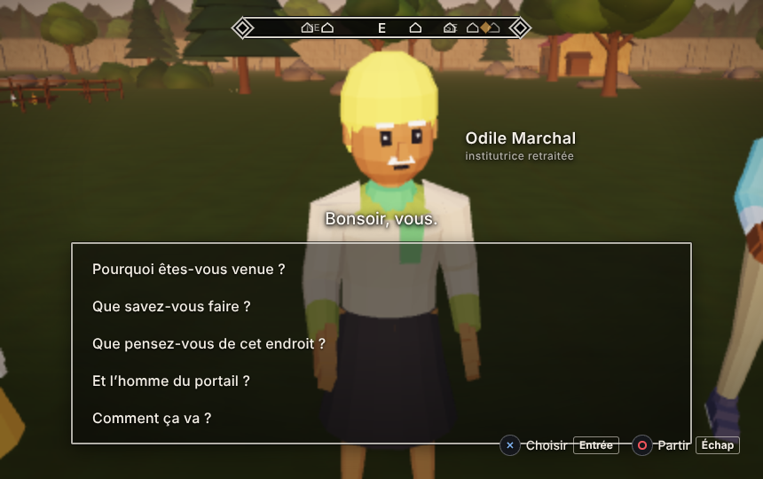

# HDF ENCLOS 1.8.0

Jeu 3D de survie et de vie de village dans le navigateur (WebGL 2), construit sur le moteur HDF WALL / FSM3D.

**Jouer en ligne : https://wwwh8hv4w5-lang.github.io/HDF-ENCLOS/**

> **Réservé aux adultes (18 ans et plus).** Le jeu contient de la violence, des agressions, des meurtres, des enlèvements et des thèmes psychologiquement durs. Un écran d'accueil le rappelle avant de jouer.

## 1.7.1 : sous le village

- **Un nouveau lieu caché** s'ouvre à partir de la deuxième boucle. Les villageois en parlent à mots couverts ; à vous de trouver où, et ce qui s'y trouve.
- **Une lampe torche** rejoint le sac : elle s'allume et s'éteint à la demande, utile là où il fait toujours nuit.
- **Le train de la fin secrète est refait** (nouvelle rame, sièges, portes).
- **Les fins secrètes se terminent par une cinématique** : « Le train de nuit ». Elle est dans un fichier à part, placé à côté de `index.html`.
- Les anciennes sauvegardes se chargent sans changement.

## 1.6.2 : le fichier se lance en local

- Le fichier `index.html` ouvert directement sur l'appareil (reçu par mail, enregistré dans Fichiers) démarre maintenant aussi sur Safari, iPhone et iPad compris. Avant, seule la page en ligne fonctionnait.
- Le fichier est autonome : aucune connexion ni serveur nécessaire.
- Si l'écran indique que JavaScript est nécessaire, c'est que vous êtes dans un aperçu (pièce jointe, aperçu rapide) : ouvrez le fichier dans un navigateur ou jouez en ligne.
- Les sauvegardes se chargent sans changement.

## 1.6.1 : correctifs

- Le carnet ne se referme plus tout seul quand on s'installe pour écrire dans une maison : la touche d'action restée appuyée ne choisit plus à votre place.
- Une sauvegarde faite au mauvais moment pouvait bloquer une découverte pour toujours. C'est corrigé, et les sauvegardes concernées sont réparées au chargement.
- Les anciennes sauvegardes se chargent sans changement.

## 1.6.0 : une issue de plus

- **Le jeu a désormais une fin secrète**, distincte de la fin classique et de la boucle. Rien ne l'annonce : ni le menu, ni le carnet, tant qu'on ne l'a pas trouvée.
- Les anciennes sauvegardes se chargent sans changement.

## 1.5.4 : ce que cache la trappe

- **La trappe sous le buisson ne reste pas bloquée pour toujours.** Ce qui l'ouvre est quelque part dans l'enclos. Le reste est à découvrir en jouant.
- Les anciennes sauvegardes se chargent sans changement : les nouveautés partent de zéro.

## 1.5.3 : la trappe sous le buisson

- **À l'ouest de l'enclos**, loin des chemins, un massif isolé cache une vieille trappe en bois : planches patinées, deux bandes de fer rivetées, pentures, verrou rouillé, anneau de fer, mousse et feuilles mortes. On ne la voit vraiment qu'en s'approchant.
- **Agir** (E, Carré à la manette, bouton Agir sur iPhone) : « Ouvrir la trappe » → « C’est bloqué ». Rien d'autre ne se passe : pas de quête, rien de sauvegardé.
- **Dessous**, dans le sol : un puits carré cerclé de pierre et de bois, une échelle, puis une grande salle (12 × 9 m, 3 m sous plafond) avec poutres, étagères, caisses, tonneau, table et lampe-tempête. Une vieille photo sépia, « CUBE 01 · SECTEUR OMEGA », traîne au sol, sous la lampe. Elle n'est pas accessible pour l'instant et ne coûte rien à l'affichage tant qu'on reste à la surface.
- Les sauvegardes ne changent pas.

## 1.5.2 : mode iPhone, commandes au pouce

- **Le jeu reconnaît l'iPhone** (et les téléphones tactiles) et passe tout seul en mode iPhone : la page prend la largeur réelle de l'écran (avant, Safari la dessinait sur 980 px, d'où une interface minuscule) et respecte l'encoche et la barre d'accueil.
- **Pouce gauche :** une manette flottante apparaît sous le pouce, avec une petite zone morte et une montée douce. Pousser au-delà de l'anneau fait courir.
- **Pouce droit :** un gros bouton **Agir** affiche l'action possible (Entrer, Grimper…), entouré de Sauter / Grimper, Courir, S'accroupir et la roue. Glisser ailleurs fait tourner la caméra, en même temps que la marche.
- **Options › Commandes et caméra** (accueil et menu de pause) : commandes Auto / Tactile / Clavier et souris, sensibilité de la caméra, axe vertical inversé, graphismes Auto / Économie, aide pour le plein écran.
- Pas de zoom, de loupe ni de sélection de texte par erreur. Aucun doigt ne reste « collé ». Le jeu se met en pause quand on quitte Safari.
- Le clavier, la souris, la manette et la sauvegarde ne changent pas. Les réglages des commandes sont gardés à part (`hdf-enclos-commandes`).

## 1.5.1 : la panique au village, fin de partie corrigée

- **La panique :** quand vous révélez la salle sous le mur, le village l'apprend. Une scène éclate la première fois que vous retrouvez des habitants, puis ils réagissent selon leur caractère (premiers mots, saluts, conversations surprises pendant quelques jours). Les habitants oublient à chaque boucle, vous seul vous souvenez.
- **Fin de partie :** le récit de la mère s'affiche enfin au-dessus de l'écran de fin, et une blouse blanche en poursuite ne peut plus relancer une boucle une fois que vous êtes évadé.
- Le mot « boucle » reste caché avant la première capture (menu, options, carnet).

## 1.5.0 : plus fluide, plus léger, plus autonome

- **Horloge à pas fixe :** le temps réel écoulé est rattrapé par petits pas de 50 ms au plus ; sous 20 images par seconde, le jeu ne ralentit plus.
- **Bouton Options réparé** sur l'écran d'accueil.
- **Notifications empilées :** jusqu'à 3 messages à la fois, durée selon la longueur du texte.
- **Plus aucune ressource distante :** les polices Google sont retirées (polices installées ou équivalents système).
- Le paquet de véhicules, jamais utilisé, est retiré (−222 Ko).
- Les sauvegardes ne changent pas.

## 1.4.0 : l'atelier défile, le sac à dos est refait

- **Atelier (onglet Fabriquer) :** toutes les recettes se voient enfin, au doigt, à la souris, aux flèches du clavier et à la manette. La recette choisie reste toujours à l'écran, et un fondu avec « ▾ Plus bas » montre qu'il en reste.
- **Nouveau sac à dos :**
  - un panneau de cuir et de toile, qui s'ouvre avec une petite animation ;
  - une grille avec les places libres visibles (8, 12 ou 16), un dessin pour chacun des 60 objets et un badge de quantité ;
  - une fiche détaillée avec un grand dessin, la description, les effets (satiété, soif, santé…) et les boutons Manger, Boire, Soigner ou Jeter ;
  - des filtres par catégorie, avec le compte des places libres ;
  - les objets de quête sont rangés à part, dans les poches.
- **Commandes du sac :**
  - clavier : flèches, Entrée pour utiliser, Suppr pour jeter, Tab pour changer de rubrique, I ou Échap pour fermer ;
  - manette : croix directionnelle, ✕ pour utiliser, L1/R1 pour changer de rubrique, ○ pour fermer.
- Les sauvegardes ne changent pas.

## 1.3.2 : pas de sommeil pendant la fouille

- Impossible de dormir tant que les scientifiques sont là, de l'arrivée du train en gare à son départ complet : lit de la maison, nuit à deux et lit de camp de la réserve. Le bouton passe en gris, « Impossible de dormir · scientifiques ici », et le jeu l'explique : « Impossible de dormir : les scientifiques sont dans l'enceinte. »
- Si vous dormez quand le train arrive, vous êtes toujours réveillé (avant : 7 fois sur 10), et le temps repasse aussitôt à la vitesse normale.
- L'évanouissement (santé à 0) n'est pas concerné.

## 1.3.1 : correctif du dialogue

- La liste des phrases du dialogue défile enfin jusqu'à la phrase choisie (manette, flèches du clavier) ; elle revient en haut à chaque nouvelle réplique ; un léger fondu signale qu'il reste des phrases plus bas (ou plus haut) ; les phrases ne sont plus écrasées les unes sur les autres ; le défilement au doigt est explicitement autorisé.

## 1.3 : l'action et le texte

- Infiltration pendant les fouilles, poursuites (voleur, provocateur), évasion chronométrée, corps à corps, épreuves (porter, grimper, soulever).
- Le texte va à l'essentiel ; les révélations se jouent en scènes.
- Voix : après un rechargement (Continuer, Charger) ou une partie lancée à la manette, un écran « Touchez l'écran pour reprendre » demande un geste pour le son et les voix. Le détail est dans NOTE.md.

## Contenu
- `index.html` : le jeu complet, un seul fichier.
- `NOTE.md` : note technique détaillée (contenu, lots, comment ajouter une maison).
- `images/` : tableaux, affiches et drapeau du jeu.
- `captures/` : les captures d'écran du banc de test de la 1.3 (114 images).
- `outils/` : fichiers de développement pour les mises à jour rapides : `correctif-roundBox.diff` (correctif roundBox), `banc.js` (banc de test automatisé) et `banc_resultat.json` (résultats du dernier passage du banc).

© FERAL SYSTEM MEDIA
